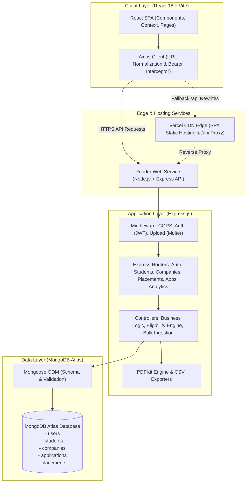
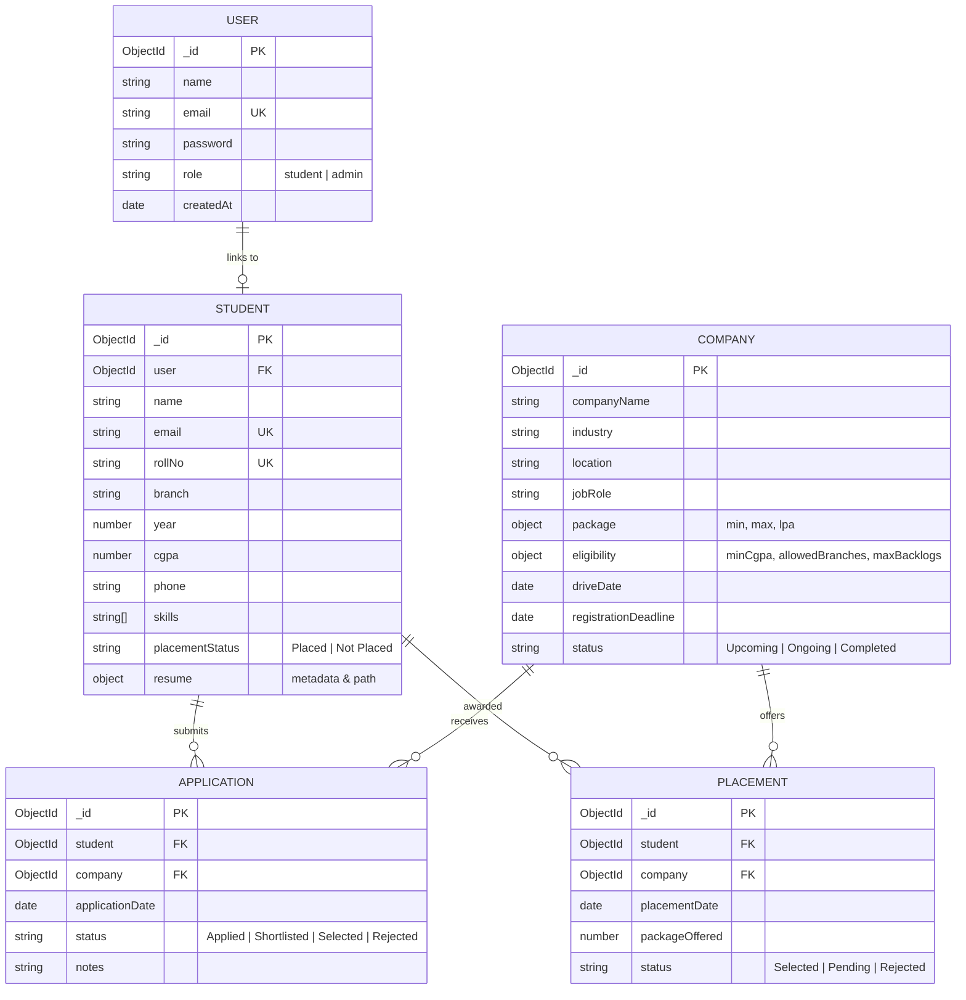

# College Placement Management and Analytics System

[](https://nodejs.org/)
[](https://expressjs.com/)
[](https://react.dev/)
[](https://vitejs.dev/)
[](https://www.mongodb.com/atlas)
[](https://student-placement-tracker-otr9.vercel.app)
[](https://studentplacementtracker.onrender.com)
[](LICENSE)

A full-stack enterprise campus placement platform engineered using the **MERN** (MongoDB, Express.js, React 18, Node.js) technology stack. The system centralizes, automates, and streamlines university recruitment drives — empowering Training and Placement Officers (TPOs) with automated eligibility checking, spreadsheet bulk student onboarding, deduplicated placement tracking, and audit-ready PDF/CSV analytics reporting, while providing graduating students with a unified portal for resume hosting, drive discovery, and real-time application tracking.

---

## Deployment & Repository Links

- **Live Application (Frontend on Vercel):** [https://student-placement-tracker-otr9.vercel.app](https://student-placement-tracker-otr9.vercel.app)
- **API Cloud Service (Backend on Render):** [https://studentplacementtracker.onrender.com](https://studentplacementtracker.onrender.com)
- **GitHub Repository:** [https://github.com/sravanthi8247/College-Placement-Management-and-Analytics-System](https://github.com/sravanthi8247/College-Placement-Management-and-Analytics-System)

---

## Table of Contents

1. [Abstract](#1-abstract)
2. [Problem Statement](#2-problem-statement)
3. [Objectives](#3-objectives)
4. [Key Features](#4-key-features)
5. [Technologies Used](#5-technologies-used)
6. [System Architecture](#6-system-architecture)
7. [Application Workflow](#7-application-workflow)
8. [Project Folder Structure](#8-project-folder-structure)
9. [Prerequisites](#9-prerequisites)
10. [Installation and Setup](#10-installation-and-setup)
11. [Environment Variables](#11-environment-variables)
12. [Running Locally](#12-running-locally)
13. [Main API Endpoints](#13-main-api-endpoints)
14. [Database Overview](#14-database-overview)
15. [Security & Data Integrity Features](#15-security--data-integrity-features)
16. [Future Enhancements](#16-future-enhancements)
17. [Author Information](#17-author-information)
18. [License](#18-license)

---

## 1. Abstract

Campus recruitment is a cornerstone academic and operational metric for higher education institutions. However, conventional campus placement coordination often relies on fragmented spreadsheets, ad-hoc physical document verification, and uncoordinated email communications. This disjointed model introduces significant administrative overhead, human error during eligibility screening, and delays in disseminating drive notices to eligible students.

The **College Placement Management and Analytics System** addresses these operational bottlenecks by providing a unified, secure, and responsive web platform. Built with modern full-stack web standards, the system implements role-based access control (RBAC), automated eligibility verification against company criteria (CGPA, academic backlogs, branch restrictions), automated batch ingestion of student rosters via CSV/Excel, and structured recruitment pipeline tracking. Furthermore, the platform integrates a dynamic analytics engine with server-side PDF generation (PDFKit) and multi-entity CSV exporting, delivering real-time institutional metrics for administrative decision-making and academic accreditation (e.g., NAAC, NBA).

---

## 2. Problem Statement

Educational institutions face persistent operational hurdles during campus placement seasons:

1. **Information Fragmentation:** Student academic profiles, company job requirements, and interview outcomes are maintained across disconnected spreadsheets, creating data discrepancies.
2. **Manual Eligibility Verification:** Placement teams spend countless hours filtering candidate rosters against company eligibility thresholds (CGPA cutoffs, allowed engineering disciplines, backlogs), leading to oversights and delayed submissions.
3. **Lack of Student Transparency:** Graduating students frequently miss registration deadlines or remain uninformed about their application status across multi-stage selection rounds.
4. **Data Redundancy & Duplicate Placements:** Students receiving multiple offers risk being double-counted in aggregate placement rates, skewing college statistical claims.
5. **Slow Institutional Reporting:** Generating accreditation-ready summaries and branch-wise placement breakdowns requires days of manual data aggregation.

---

## 3. Objectives

The primary objectives of this final-year engineering project are:

- **Centralized Data Management:** Create a consolidated, secure database for students, corporate recruiters, campus placement drives, applications, and verified placement offers.
- **Rule-Based Eligibility Automation:** Build an automated eligibility evaluation engine that instantaneously validates student eligibility before application submission.
- **Role-Based Workflows:** Implement strict authorization barriers separating administrative operations (TPO) from student applicant actions.
- **High-Throughput Student Ingestion:** Support bulk roster onboarding through spreadsheet upload (`.csv` and `.xlsx`) with instant preview, validation, and error reporting.
- **Accurate Placement Analytics:** Calculate deduplicated placement metrics (unique students placed vs. Total offers issued) and provide instant PDF reports and CSV exports.
- **High Availability & Security:** Deploy an optimized SPA frontend and cloud backend with secure JWT authentication, encrypted passwords, and protected CORS headers.

---

## 4. Key Features

### 4.1 Authentication & Role-Based Access Control (RBAC)
- **JWT Stateless Authentication:** Secure session management using JSON Web Tokens passed in HTTP Bearer headers.
- **Bcrypt Password Security:** Password hashing with 10 salt rounds prior to persistence.
- **Controlled Admin Registration:** Public signups default to student privileges; administrative accounts require a cryptographically verified server-side invite code (`ADMIN_INVITE_CODE`).
- **Profile Self-Healing:** Authenticated students without pre-existing profiles are automatically linked to a synchronized student record upon registration.

### 4.2 Student Portal Features
- **Student Profile Management:** Maintain academic history, branch, graduation year, CGPA, contact phone, and technical skills.
- **PDF Resume Upload & Preview:** Upload, replace, and delete PDF resumes (enforcing PDF MIME checks and 2 MB limits); view uploaded resumes in-browser with secure streaming endpoints.
- **Placement Drives Directory (`/drives`):** Browse upcoming, ongoing, and completed campus drives with search and status filtering.
- **Instant Eligibility Assessment:** Live calculation evaluating individual student eligibility (CGPA cutoff, allowed branch, backlog criteria) with clear explanatory messages.
- **Drive Details & One-Click Application (`/drives/:id`):** View job descriptions, compensation packages, drive dates, and apply in one click.
- **My Applications Pipeline (`/applications`):** Track multi-stage application progress in real time (`Applied` &rarr; `Shortlisted` &rarr; `Selected` &rarr; `Rejected`).

### 4.3 Training & Placement Officer (TPO / Admin) Features
- **Paginated Student Directory (`/students`):**
  - Displays registered students with server-side pagination (defaulting to 25 records per page, toggleable to 50).
  - Debounced multi-field search (by Name, Roll Number, Email, Branch).
  - Multi-attribute filtering (Placement Status, Engineering Branch, Academic Year, Minimum CGPA).
  - Complete record management (Add, Edit, and Delete student records).
- **Bulk Spreadsheet Import (`/students/import`):**
  - Download standardized CSV and Excel (`.xlsx`) import templates.
  - In-browser preview validating row schemas, data types, and uniqueness constraints before committing to the database.
  - Batch insertion skipping duplicate records with downloadable error logs.
- **Company & Placement Drive Management (`/companies`):**
  - Register corporate partners and configure drive specifications.
  - Set eligibility criteria (minimum CGPA, allowed branches, maximum backlogs).
  - Configure multi-round hiring workflows (e.g., Written Test, Technical Interview, HR Round).
- **Placement Offer Management (`/placements`):**
  - Searchable student selector fetching candidates by Name, Roll Number, or Branch.
  - Record compensation packages (LPA), offer dates, and selection statuses.
  - **Database-Level Duplicate Prevention:** A unique compound index (`{ student: 1, company: 1 }`) prevents duplicate placement entries for the same student-company pair.
- **Unified Analytics & Reporting (`/reports`):**
  - Real-time KPI summaries: Total Students, Placed Students, Overall Placement %, Active Drives, Average Package, Highest Package.
  - **Deduplicated Analytics:** Distinguishes between unique placed students and total job offers, avoiding double-counting multi-offer recipients.
  - **Professional PDF Report Generation:** Produces clean, institutional PDF placement summaries using `pdfkit` (including institutional header, branch breakdowns, company selections, package analytics, and page numbers).
  - **CSV Data Exports:** One-click CSV exports for Student rosters, Company applications, and Placement records.

---

## 5. Technologies Used

| Tier / Category | Technology / Library | Version | Role in Project |
|---|---|---|---|
| **Frontend Framework** | React.js | `^18.3.1` | Component-driven Single Page Application (SPA) architecture |
| **Build Tool & Bundler** | Vite | `^5.4.11` | High-performance build tool with optimized ES module bundling |
| **Client-Side Routing** | React Router DOM | `^7.18.1` | Declarative client-side routing with role-guarded routes |
| **HTTP Client** | Axios | `^1.18.1` | Promise-based API communication with request/response interceptors |
| **Backend Runtime** | Node.js | `>=18.x` | Asynchronous event-driven server runtime environment |
| **Web Framework** | Express.js | `^4.21.2` | RESTful API server, middleware routing, and error handling |
| **Database** | MongoDB Atlas | Cloud Cluster | NoSQL document database hosting collections and compound indexes |
| **Object Data Modeling** | Mongoose | `^8.9.3` | Schema validation, business models, and aggregation pipelines |
| **Authentication & Tokens** | JSON Web Tokens (`jsonwebtoken`) | `^9.0.3` | Stateless token generation, distribution, and verification |
| **Password Encryption** | Bcrypt.js | `^3.0.3` | One-way cryptographic password hashing using 10 salt rounds |
| **File Upload Handling** | Multer | `^2.4.0` | Multi-part form data processing for resume uploads & spreadsheets |
| **Spreadsheet Ingestion** | XLSX (SheetJS) | `^0.18.5` | Parsing and generation of Excel (`.xlsx`) and CSV files |
| **PDF Document Engine** | PDFKit | `^0.20.2` | Dynamic programmatic generation of placement reports |
| **CORS Middleware** | CORS | `^2.8.5` | Origin whitelisting and preflight `OPTIONS` request handling |
| **Environment Config** | Dotenv | `^16.4.7` | Twelve-factor app configuration via environment variables |
| **Frontend Hosting** | Vercel | Cloud Platform | Global CDN edge hosting with SPA routing and API reverse-proxy |
| **Backend Hosting** | Render | Cloud Platform | Web service container hosting the Node.js Express API |

---

## 6. System Architecture

The system utilizes a decoupled, three-tier client-server architecture:



---

## 7. Application Workflow

### 7.1 Student User Journey
1. **Registration / Login:** Student signs up or logs in. If their student record was pre-imported, the account auto-associates with their academic record via email.
2. **Profile Completion & Resume:** The student checks their profile details (Branch, CGPA, Phone, Skills) and uploads a PDF resume (max 2 MB).
3. **Explore Campus Drives:** Browses available placement drives under `/drives`.
4. **Eligibility Verification:** The system automatically compares student credentials against the drive's minimum CGPA, allowed engineering disciplines, and active backlogs.
5. **Apply:** If eligible, the student submits their application with a single click.
6. **Track Status:** The student views their interview status (`Applied`, `Shortlisted`, `Selected`, `Rejected`) under `/applications`.

### 7.2 Training & Placement Officer (Admin) Journey
1. **Administrative Login:** Authenticates using admin credentials verified with an internal invite code.
2. **Bulk Ingest Students:** Uploads the batch student spreadsheet (`.csv` or `.xlsx`) under `/students/import`. The system validates every row, highlights format or duplicate errors, and batch-inserts valid students.
3. **Drive Registration:** Creates a company profile under `/companies`, configuring job roles, salary package, drive schedule, and eligibility criteria.
4. **Application Pipeline Review:** Reviews applicant rosters for active drives, shortlists qualifying candidates, and updates interview rounds.
5. **Record Placement Confirmations:** Logs finalized hiring offers under `/placements` with salary details (LPA). The compound index protects against accidental duplicate entries.
6. **Generate Institutional Reports:** Inspects live KPIs on the Dashboard, downloads accreditation-ready PDF placement summaries, and exports raw CSV data for institutional analysis.

---

## 8. Project Folder Structure

```
College-Placement-Management-and-Analytics-System/
├── client/                                  # React frontend (Vite SPA)
│   ├── public/                              # Static public assets
│   ├── src/
│   │   ├── components/                      # Reusable modular UI components
│   │   │   ├── layout/                      # Navbar, Sidebar, AppLayout
│   │   │   ├── ui/                          # Alerts, Buttons, Badges
│   │   │   ├── CompanyForm.jsx              # Modal/Form for company creation
│   │   │   ├── PlacementForm.jsx            # Form for recording student placements
│   │   │   ├── StudentForm.jsx              # Form for manual student entry/editing
│   │   │   ├── StudentSearchSelector.jsx    # Paginated searchable student picker
│   │   │   └── ProtectedRoute.jsx           # Role-based route guard component
│   │   ├── context/
│   │   │   └── AuthContext.jsx              # Global authentication context & state
│   │   ├── pages/                           # Application view pages
│   │   │   ├── Applications.jsx             # Student application pipeline
│   │   │   ├── BulkImportStudents.jsx       # CSV/XLSX import with live preview
│   │   │   ├── Companies.jsx                # Company & drive management
│   │   │   ├── Dashboard.jsx                # Analytics dashboard with KPI cards
│   │   │   ├── DriveDetail.jsx              # Individual drive details & eligibility
│   │   │   ├── Drives.jsx                   # Student drive discovery portal
│   │   │   ├── LandingPage.jsx              # Public institutional landing page
│   │   │   ├── Login.jsx                    # User login page
│   │   │   ├── Placements.jsx               # Placement record management
│   │   │   ├── Profile.jsx                  # Student profile & resume upload
│   │   │   ├── Register.jsx                 # Public signup page
│   │   │   ├── Reports.jsx                  # Analytics, PDF generation, CSV exports
│   │   │   └── Students.jsx                 # Paginated student directory (25/50 per page)
│   │   ├── services/                        # API client services (Axios)
│   │   │   ├── api.js                       # Base Axios instance with interceptors
│   │   │   ├── applicationService.js        # Drive application API endpoints
│   │   │   ├── authService.js               # Login, registration, profile fetch
│   │   │   ├── companyService.js            # Company & drive API endpoints
│   │   │   ├── placementService.js          # Placement records API endpoints
│   │   │   └── studentService.js            # Student CRUD, import, resume endpoints
│   │   ├── styles/                          # Component and theme stylesheets
│   │   ├── App.jsx                          # Main routing setup
│   │   ├── main.jsx                         # React DOM mount point
│   │   └── index.css                        # Global CSS variables and base reset
│   ├── .env.example                         # Example environment configuration for client
│   ├── index.html                           # HTML template
│   ├── package.json                         # Client dependencies and build scripts
│   ├── vercel.json                          # Vercel deployment & API rewrite config
│   └── vite.config.js                       # Vite development & build configuration
│
├── server/                                  # Express backend (Node.js REST API)
│   ├── config/
│   │   └── db.js                            # MongoDB Atlas connection handler
│   ├── controllers/                         # Request handlers and business logic
│   │   ├── analyticsController.js           # Analytics aggregation, PDF, CSV exports
│   │   ├── applicationController.js         # Student drive applications & stages
│   │   ├── authController.js                # User authentication & registration
│   │   ├── companyController.js             # Companies, drives, eligibility checking
│   │   ├── placementController.js           # Placement tracking & duplicate validation
│   │   └── studentController.js             # Student CRUD, pagination, bulk import
│   ├── middleware/                          # Custom Express middleware
│   │   ├── authMiddleware.js                # JWT protection & role authorization
│   │   ├── errorMiddleware.js               # 404 handler & centralized error response
│   │   └── uploadMiddleware.js              # Multer storage configuration for uploads
│   ├── models/                              # Mongoose data models
│   │   ├── Application.js                   # Application schema (unique student+company)
│   │   ├── Company.js                       # Company & recruitment drive schema
│   │   ├── Placement.js                     # Placement schema (unique student+company)
│   │   ├── Student.js                       # Student academic profile & resume schema
│   │   └── User.js                          # User credentials & role schema
│   ├── routes/                              # Express REST route definitions
│   │   ├── analyticsRoutes.js               # /api/analytics
│   │   ├── applicationRoutes.js             # /api/applications
│   │   ├── authRoutes.js                    # /api/auth
│   │   ├── companyRoutes.js                 # /api/companies
│   │   ├── placementRoutes.js               # /api/placements
│   │   └── studentRoutes.js                 # /api/students
│   ├── uploads/                             # Upload directory for student resumes
│   ├── utils/                               # Helper utilities
│   │   ├── csv.js                           # CSV data serialization helper
│   │   ├── pdfReport.js                     # Programmatic PDF generation (PDFKit)
│   │   ├── studentImport.js                 # Spreadsheet parsing & validation logic
│   │   └── studentProfile.js                # Student profile association helpers
│   ├── .env.example                         # Example environment configuration for server
│   ├── package.json                         # Server dependencies and scripts
│   └── server.js                            # Express app entry point & CORS configuration
│
├── .gitignore                               # Git ignored files (.env, node_modules, dist)
├── LICENSE                                  # MIT License
└── README.md                                # Comprehensive project documentation
```

---

## 9. Prerequisites

Before installing and executing the project locally, ensure you have the following software installed:

- **Node.js:** `v18.x` or `v20.x` (LTS recommended) &rarr; [Download Node.js](https://nodejs.org/)
- **npm:** `v9.x` or higher (bundled with Node.js)
- **MongoDB:** A free [MongoDB Atlas](https://www.mongodb.com/atlas) cloud cluster **OR** a local MongoDB Community Server (`v6.0+`)
- **Git:** Installed and available on your system path &rarr; [Download Git](https://git-scm.com/)
- **Terminal:** Windows PowerShell, macOS Terminal, or Linux Bash

Verify installations in Windows PowerShell:
```powershell
node -v
npm -v
git --version
```

---

## 10. Installation and Setup

### Step 1: Clone the Repository
Clone the repository using Git and navigate to the project root directory:

```powershell
git clone https://github.com/sravanthi8247/College-Placement-Management-and-Analytics-System.git
cd College-Placement-Management-and-Analytics-System
```

### Step 2: Install Server Dependencies
Navigate into the `server` directory and install all backend dependencies:

```powershell
cd server
npm install
```

### Step 3: Install Client Dependencies
Open a second terminal window (or navigate to `client`) and install frontend packages:

```powershell
cd ../client
npm install
```

---

## 11. Environment Variables

The project uses separate `.env` files for the server and client to safeguard sensitive credentials.

> [!CAUTION]
> Never commit actual `.env` files to public version control. The `.gitignore` file is configured to exclude all `.env` files. Always use strong, unique secrets in production environments.

### 11.1 Backend Configuration (`server/.env`)
Create a `.env` file inside the `server/` directory:

```powershell
# Copy the example file in server directory
Copy-Item .env.example .env
```

Populate `server/.env` with your actual configuration values:

```env
# Server Runtime
PORT=5000
NODE_ENV=development

# MongoDB Atlas Database Connection URI
MONGO_URI=mongodb+srv://<username>:<password>@<cluster-url>/placement_db?retryWrites=true&w=majority

# CORS Allowed Client Origin (local development)
CLIENT_URL=http://localhost:5173

# JSON Web Token Secret & Expiration
JWT_SECRET=your_super_secret_jwt_key_min_32_characters_long
JWT_EXPIRES_IN=7d

# Secret Code required to register an Admin account
# Public registrations without this code automatically default to student role
ADMIN_INVITE_CODE=your_secret_admin_invite_code
```

### 11.2 Frontend Configuration (`client/.env`)
Create a `.env` file inside the `client/` directory:

```powershell
# Copy the example file in client directory
Copy-Item .env.example .env
```

Populate `client/.env` as follows:

```env
# Leave empty for local development (Vite proxies /api to http://localhost:5000)
# In production, set to your deployed backend URL (e.g., https://studentplacementtracker.onrender.com/api)
VITE_API_URL=
```

---

## 12. Running Locally

To run the application locally on Windows using PowerShell:

### Terminal 1 — Start the Backend Server (Port 5000)
```powershell
cd C:\Sravanthi\StudentPlacementTracker-FINAL\StudentPlacementTracker-main\server
npm run dev
```
*The server will start with Nodemon at `http://localhost:5000` and connect to MongoDB Atlas.*

### Terminal 2 — Start the Frontend Development Server (Port 5173)
```powershell
cd C:\Sravanthi\StudentPlacementTracker-FINAL\StudentPlacementTracker-main\client
npm run dev
```
*The Vite development server will start at `http://localhost:5173`.*

Open your web browser and navigate to:
```
http://localhost:5173
```

---

## 13. Main API Endpoints

All primary application endpoints reside under the `/api` route prefix. Protected endpoints require an `Authorization: Bearer <token>` header.

### 13.1 Authentication Routes (`/api/auth`)
| Method | Endpoint | Access | Description |
|---|---|---|---|
| `POST` | `/api/auth/register` | Public | Register a new user (defaults to `student`; accepts `adminInviteCode` for `admin`) |
| `POST` | `/api/auth/login` | Public | Authenticate user credentials and return a signed JWT token |
| `GET` | `/api/auth/me` | Authenticated | Retrieve authenticated user account information |

### 13.2 Student Management & Profile Routes (`/api/students`)
| Method | Endpoint | Access | Description |
|---|---|---|---|
| `GET` | `/api/students/me` | Student | Retrieve the authenticated student's profile (with auto-provisioning) |
| `PUT` | `/api/students/me` | Student | Update authenticated student profile details |
| `GET` | `/api/students/me/resume` | Student | Stream/download the authenticated student's uploaded PDF resume |
| `POST` | `/api/students/me/resume` | Student | Upload/replace PDF resume (multipart form, 2 MB max) |
| `DELETE` | `/api/students/me/resume` | Student | Delete authenticated student's resume |
| `GET` | `/api/students/:id/resume` | Admin | Stream/download any student's resume by student ID |
| `GET` | `/api/students` | Admin | Paginated student list (`page`, `limit`, `search`, `status`, `branch`, `year`, `minCgpa`) |
| `POST` | `/api/students` | Admin | Manually add a single student record |
| `PUT` | `/api/students/:id` | Admin | Update an existing student record |
| `DELETE` | `/api/students/:id` | Admin | Delete a student record |
| `GET` | `/api/students/import/template` | Admin | Download bulk import template file (`?format=csv` or `?format=xlsx`) |
| `POST` | `/api/students/import/preview` | Admin | Validate and preview uploaded spreadsheet before importing |
| `POST` | `/api/students/import` | Admin | Commit bulk spreadsheet import into the database |
| `POST` | `/api/students/import/error-report`| Admin | Download CSV error report for skipped/invalid import rows |
| `GET` | `/api/students/dashboard/stats` | Authenticated | High-level student count and placement status metrics |

### 13.3 Companies & Drives Routes (`/api/companies`)
| Method | Endpoint | Access | Description |
|---|---|---|---|
| `GET` | `/api/companies` | Authenticated | List all companies and placement drives |
| `GET` | `/api/companies/:id` | Authenticated | Get detailed profile of a specific company drive |
| `POST` | `/api/companies` | Admin | Create a new company profile and recruitment drive |
| `PUT` | `/api/companies/:id` | Admin | Update company drive details, dates, or eligibility |
| `DELETE` | `/api/companies/:id` | Admin | Delete a company drive |
| `GET` | `/api/companies/:id/eligibility/me` | Student | Check current logged-in student's eligibility for the drive |
| `GET` | `/api/companies/:id/eligibility/:studentId` | Authenticated | Evaluate eligibility of a specific student for the drive |
| `GET` | `/api/companies/:id/eligible-students` | Admin | List all eligible students matching company criteria |

### 13.4 Applications Pipeline Routes (`/api/applications`)
| Method | Endpoint | Access | Description |
|---|---|---|---|
| `POST` | `/api/applications` | Student | Apply to a placement drive (validates eligibility criteria) |
| `GET` | `/api/applications` | Authenticated | List applications (students see their own; admins see all) |
| `GET` | `/api/applications/stats/:companyId` | Admin | View application status breakdown for a specific company |
| `PUT` | `/api/applications/:id` | Admin | Update candidate status (`Applied`, `Shortlisted`, `Selected`, `Rejected`) |

### 13.5 Placement Records Routes (`/api/placements`)
| Method | Endpoint | Access | Description |
|---|---|---|---|
| `GET` | `/api/placements` | Admin | Retrieve all confirmed placement records |
| `POST` | `/api/placements` | Admin | Record a student placement (enforces unique student-company index) |
| `PUT` | `/api/placements/:id` | Admin | Update placement offer details or status |
| `DELETE` | `/api/placements/:id` | Admin | Remove a placement record and synchronize student placement status |

### 13.6 Analytics & Reports Routes (`/api/analytics`)
| Method | Endpoint | Access | Description |
|---|---|---|---|
| `GET` | `/api/analytics` | Admin | Retrieve unified dashboard analytics (deduplicated placement metrics) |
| `GET` | `/api/analytics/export/pdf` | Admin | Generate and download official institutional PDF placement report |
| `GET` | `/api/analytics/export/students` | Admin | Export entire student database roster as CSV |
| `GET` | `/api/analytics/export/applications` | Admin | Export all application pipeline records as CSV |
| `GET` | `/api/analytics/export/placements` | Admin | Export confirmed placement records as CSV |

### 13.7 System Health Route
| Method | Endpoint | Access | Description |
|---|---|---|---|
| `GET` | `/api/health` | Public | Liveness probe returning server status and uptime |

---

## 14. Database Overview

The platform uses MongoDB Atlas with five interrelated Mongoose collections:



### Key Database Indexes & Constraints
1. **Student Uniqueness:** Unique index on `Student.rollNo` and `Student.email` prevents duplicate student identities.
2. **Placement Duplicate Prevention:** Compound unique index on `Placement` collection:
   ```javascript
   PlacementSchema.index({ student: 1, company: 1 }, { unique: true });
   ```
   Ensures a student cannot have multiple placement records registered for the same company.
3. **Application Duplicate Prevention:** Compound unique index on `Application` collection:
   ```javascript
   ApplicationSchema.index({ student: 1, company: 1 }, { unique: true });
   ```
   Prevents students from submitting multiple applications to the exact same recruitment drive.

---

## 15. Security & Data Integrity Features

- **Stateless Token Verification:** All sensitive endpoints enforce JWT Bearer token authentication via [`authMiddleware.js`](file:///server/middleware/authMiddleware.js).
- **Role-Based Authorization (RBAC):** Express middleware `authorize('admin')` isolates all destructive administrative endpoints from student access.
- **Admin Registration Guard:** Preventing unauthorized admin escalation by mandating a confidential server-side invite code during admin registration.
- **Strict CORS Policy:** Backend [`server.js`](file:///server/server.js) dynamically validates request origins against production frontend URLs, preview environments, and configured origins, handling preflight `OPTIONS` requests securely.
- **Input Sanitization & Schema Validation:** Mongoose schemas enforce type constraints, regex matching on email/phone formats, and numeric range limits (CGPA 0.0–10.0, Year 1–4).
- **File Upload Security:** Multer upload limits enforce a 2 MB file cap and validate MIME types to accept only authentic PDF files for resumes.
- **Safe Error Handling:** Production error responses withhold internal server stack traces to prevent reconnaissance vulnerabilities.

---

## 16. Future Enhancements

Potential extensions planned for future iterations of this platform:

1. **Automated Notification Service:** Integrate SendGrid or Nodemailer to send automated email alerts for newly scheduled drives, shortlisted status changes, and interview rounds.
2. **Interview Round Scheduling:** Interactive calendar interface allowing placement officers to allocate interview time slots and students to book interview slots.
3. **AI-Powered Resume Analysis:** Implement natural language processing (NLP) to parse resumes and score candidate skill compatibility against corporate job descriptions.
4. **Alumni Mentorship Network:** Dedicated portal module connecting placed alumni with current graduating students for career guidance and mock interviews.
5. **Multi-Tenancy Support:** Architectural scaling to support multi-college deployments under distinct organizational subdomains.

---

## 17. Author Information

- **Developer:** Sravanthi
- **Program:** Bachelor of Technology (B.Tech) in Computer Science and Engineering (CSE)
- **Project Type:** Final-Year Major Capstone Project
- **GitHub:** [@sravanthi8247](https://github.com/sravanthi8247)
- **Repository:** [College-Placement-Management-and-Analytics-System](https://github.com/sravanthi8247/College-Placement-Management-and-Analytics-System)

---


